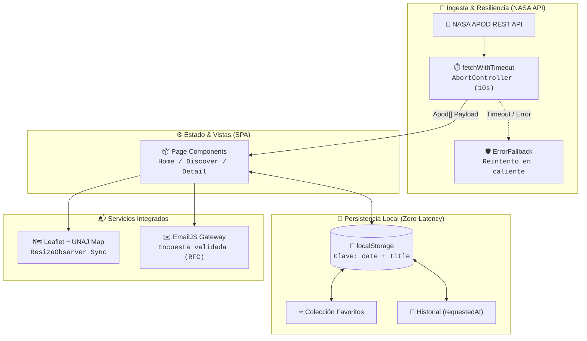

# 🛰️ APOD Explorer

> Explorador web interactivo del archivo Astronomy Picture of the Day (APOD) de la NASA, con ingesta asíncrona resiliente, filtrado cronológico dinámico, colección offline y geolocalización interactiva.

[](https://react.dev/)
[](https://www.typescriptlang.org/)
[](https://vitejs.dev/)
[](https://reactrouter.com/)
[](https://leafletjs.com/)
[](https://firebase.google.com/)

[🌐 Demo en Vivo](https://apod-explorer.maxigimenez.com.ar/)

---

## 🔭 Características Principales

* **🌌 Imagen del Día y Exploración Aleatoria:** Consulta de la foto astronómica diaria y eventos aleatorios con imágenes y videos.
* **🎛️ Búsqueda y Filtrado Temporal:** Navegación por el archivo histórico de la NASA desde 1996 hasta la actualidad, con filtros por año y mes.
* **🛡️ Tolerancia a Fallos y Manejo de Errores:** Control de demoras o caídas en la respuesta de la NASA con pantallas de aviso claras y reintento de conexión inmediato.
* **⭐ Colección de Favoritos:** Almacenamiento local de publicaciones destacadas directamente en el navegador, disponible sin necesidad de registro ni inicio de sesión.
* **📜 Historial Cronológico de Navegación:** Registro de las imágenes consultadas con fecha y hora de visita, junto con la opción de limpiar los datos en cualquier momento.
* **💬 Soporte Multilenguaje:** Experiencia adaptada a tres idiomas: Español, Inglés y Portugués.
* **🗺️ Mapa Interactivo:** Visualización geográfica de la sede de la universidad (UNAJ), adaptable a diferentes resoluciones y dispositivos.
* **📝 Formulario de Contacto y Valoración:** Envío directo de mensajes, sugerencias y valoraciones sobre la aplicación mediante un formulario integrado.

---

## 🔄 Flujo de Datos



---

## 💻 Puesta en Marcha

### Requisitos Previos
* **Node.js:** Versión 18+ (LTS recomendada)
* **Gestor de paquetes:** `npm`, `pnpm` o `yarn`
* **NASA API Key:** Gratuita en [api.nasa.gov](https://api.nasa.gov/) (o usar `DEMO_KEY` para evaluación inicial)

### Instalación y Ejecución

```bash
# 1. Clonar el repositorio
git clone https://github.com/MaximilianoGimenez0/APOD-explorer.git
cd APOD-explorer

# 2. Instalar dependencias
npm install

# 3. Configurar variables de entorno
cp .env.example .env

# 4. Iniciar el entorno de desarrollo
npm run dev
```

La aplicación quedará disponible en `http://localhost:5173`.

> **Nota sobre variables de entorno:** Configura `VITE_API_KEY=DEMO_KEY` en tu `.env` para pruebas rápidas. Las credenciales de EmailJS son opcionales si no se requiere el despacho real del formulario de contacto.

### Scripts Disponibles

```bash
npm run dev      # Inicia el servidor de desarrollo con Vite
npm run lint     # Ejecuta el análisis estático con ESLint y TypeScript
npm run build    # Compila el bundle de producción optimizado en dist/
npm run preview  # Previsualiza localmente el empaquetado de producción
```

---

## ⚙️ Stack Tecnológico

* **Frontend & UI:** React 19, TypeScript ~5.8, React Router v7, React Icons.
* **Cartografía & APIs:** Leaflet 1.9, React Leaflet, NASA APOD REST API.
* **Servicios & Almacenamiento:** EmailJS SDK, Web Storage API (`localStorage`).
* **Tooling:** Vite 7, ESLint 9, TypeScript-ESLint.
* **Hosting:** Firebase Hosting.

---

## 👨💻 Autor & Contacto

* **Maximiliano Giménez**
* **Portfolio:** [maxigimenez.com.ar](https://maxigimenez.com.ar)
* **GitHub:** [@MaximilianoGimenez0](https://github.com/MaximilianoGimenez0)
* **LinkedIn:** [Maximiliano Giménez](https://www.linkedin.com/in/maximiliano-gim%C3%A9nez-2644b0338/)